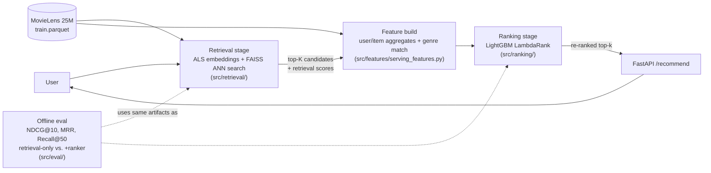

# RankForge: Two-Stage Recommendation Ranking System

Candidate generation (ANN retrieval) + learned ranking (LambdaRank), trained
and evaluated on the real MovieLens 25M dataset, with an explicit
latency/accuracy tradeoff analysis across candidate pool sizes.

## Architecture



1. **Retrieval stage** — FAISS ANN search over item embeddings from ALS
   matrix factorization (`src/retrieval/`)
2. **Feature engineering** — every feature explicitly labeled TRAIN_SAFE /
   SERVE_SAFE as a train/serve-skew guard; serve-time feature building is
   shared between eval and the live API, not duplicated (`src/features/`)
3. **Ranking stage** — LightGBM LambdaRank re-ranks retrieved candidates
   (`src/ranking/`)
4. **Serving** — FastAPI `/recommend` endpoint with per-stage latency
   instrumentation (`src/serving/`)
5. **Eval** — NDCG@10, MRR, Recall@50 for retrieval-only vs. retrieval+ranker,
   plus a latency/accuracy sweep across candidate pool sizes
   (`src/eval/`, results in `reports/RESULTS.md`)

## Quickstart

```bash
python -m pip install -r requirements-dev.txt

# Run the smoke-test suite (fabricated small data, ~3s)
python -m pytest tests/

# Full pipeline on real data (requires ml-25m.zip from grouplens.org,
# unzipped to data/raw/ml-25m/):
python -m src.data.load_movielens
python -m src.retrieval.train_als
python -m src.features.prepare_ranker --user-fraction 0.35
python -m src.ranking.train_ranker
python -m src.eval.evaluate

# Serve
python -m uvicorn src.serving.app:app --reload
# then: curl "http://127.0.0.1:8000/recommend?user_id=1&k_candidates=500&top_k=10"
```

## Historical experiment results — on real data

- ALS: 144K users, 17K items, 13M nonzero interactions (full 21M-row train set)
- FAISS flat index: sub-4ms p99 retrieval even at 2000 candidates
- LambdaRank: trained on a 35%-user sample (RAM-constrained dev environment;
  see `reports/RESULTS.md` for why)
- **Headline finding**: the ranker reliably improves Recall@50 (+16 to +21%)
  but shows mixed/negative NDCG@10 lift depending on candidate pool size —
  a genuine, investigated result, not a clean win. Full writeup, including
  the latency/accuracy Pareto frontier and three memory-scaling bugs found
  at real-data scale, in **`reports/RESULTS.md`**.
- **Serving layer** (`src/serving/app.py`): FastAPI endpoint (`/recommend`)
  loading all artifacts once at startup, with per-stage (retrieval vs.
  ranking) latency measured on every request — verified end-to-end with
  real users, real recommendations, and tested error handling (unknown user,
  invalid params). Online latency matches the offline sweep: ~2.5ms at
  k=500, ranking stage scaling with candidate count as expected.
- 5 passing pytest smoke tests covering the temporal split, feature
  assembly, LightGBM data prep, and ranking metrics correctness.

## Reproducibility repair (October 2026)

The package layout now matches the imports and commands above. Run commands from
this repository root using Python 3.11 or 3.12. Model artifacts and the MovieLens
source data are not bundled; training is required before starting the API.

The repaired pipeline reserves the final 15% of timestamps for testing. Within
its earlier period, it freezes retrieval embeddings and aggregate features on
an initial history window, then uses successive windows for ranker training and
validation. `prepare_ranker` shares the API's feature builder and computes cosine
retrieval scores. Neither validation nor test ratings enter the frozen features.
The legacy `assemble_training_features` helper uses same-row rating aggregates;
it is retained for historical context and is not used by the repaired CLI.

**The historical metrics below/in `reports/RESULTS.md` have not been rerun under
this corrected protocol. They are not performance claims for this revision.**
The 35% option samples users for ranker training/validation only. The pipeline
still trains on rated items rather than mined negatives, and the original
cold-user/item eligibility filtering examines the complete dataset. Thus this
remains a research demonstration, not an unbiased production benchmark.

## Known limitations
See `reports/RESULTS.md` for full detail — ranker trained on a 35% user
sample (not the full dataset) and no hard-negative mining are the two that
matter most; FAISS uses a flat (exact) index rather than IVF, appropriate at
this item-catalog size (18K items) but not representative of
million-item-scale retrieval; offline eval sampled 800–2000 of 144K users
per run for tractability.


